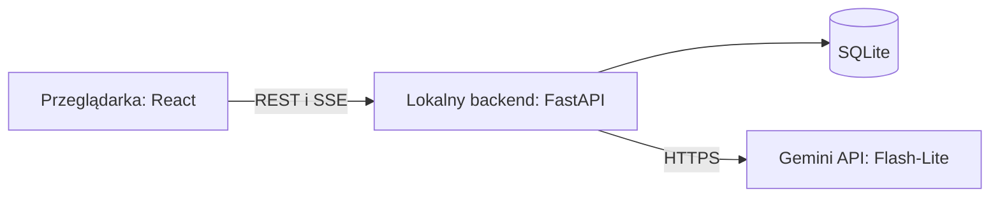

# llm-debate

Lokalna aplikacja webowa do konfigurowania, prowadzenia i analizowania debat dwóch agentów opartych na modelu językowym. Agenci reprezentują różne stanowiska w zadanym konflikcie, bronią swoich poglądów i próbują przekonać drugą stronę. Mogą zmienić stanowisko pod wpływem argumentów rozmówcy.

## Funkcje

- Interfejs, instrukcje agentów i debaty w języku polskim.
- Jasny i ciemny motyw, przełączany ikoną w górnym pasku. Wybór jest zapamiętywany w przeglądarce; przy pierwszym wejściu aplikacja korzysta z preferencji systemu.
- Dwie strony konfliktu korzystające z modelu Gemini Flash-Lite przez API.
- Zapis identyfikatora modelu w debacie i eksporcie.
- Konfiguracja scenariusza, stanowisk, celów i cech obu agentów przed rozpoczęciem rozmowy.
- Jedna aktywna debata z naprzemiennymi wypowiedziami.
- Podgląd rozmowy w formie dymków oraz sterowanie jej przebiegiem.
- Automatyczny zapis debat i przeglądanie historii.
- Eksport pojedynczej debaty do pliku JSON.

Debatę prowadzą dwie strony konfliktu, bez udziału mediatora.

## Konfiguracja debaty

### Scenariusz i przebieg

| Ustawienie | Opis | Wartość domyślna |
|---|---|---|
| Nazwa debaty | Nazwa widoczna w historii | Edytowalna nazwa nowej debaty |
| Temat | Ogólny przedmiot sporu | Pole wymagające uzupełnienia |
| Pytanie do rozstrzygnięcia | Konkretny problem, o którym mają rozmawiać strony | Pole wymagające uzupełnienia |
| Wspólny kontekst | Fakty, okoliczności i założenia dostępne obu stronom | Puste |
| Cel rozmowy | Oczekiwany kierunek debaty | Wymiana argumentów i próba przekonania rozmówcy |
| Rozpoczynający | Agent A, agent B albo losowanie | Agent A |
| Limit rund | Maksymalna liczba rund rozmowy | 10 |
| Instrukcja otwarcia | Zadanie przekazywane agentowi rozpoczynającemu | Przedstaw swoje stanowisko i najważniejsze argumenty na jego poparcie |

**Tura** oznacza jedną wypowiedź agenta. **Runda** obejmuje po jednej wypowiedzi obu stron. Limit 10 rund oznacza maksymalnie 20 wypowiedzi.

Agent sam dobiera długość wypowiedzi. Techniczny limit generowania jest przekazywany w tokenach przez API i nie jest opisywany w instrukcji agenta.

### Profile agentów

Każda strona ma oddzielny profil:

| Pole | Znaczenie |
|---|---|
| Nazwa | Nazwa uczestnika wyświetlana przy wypowiedziach |
| Rola | Opis reprezentowanej osoby, grupy lub perspektywy |
| Stanowisko | Pogląd dotyczący problemu będącego tematem debaty |
| Cel | Wynik, który agent chce osiągnąć |
| Dodatkowe instrukcje | Pole tekstowe uzupełniające instrukcję systemową agenta |

Stanowisko jest punktem wyjścia debaty. Ewentualna zmiana zdania wynika z przebiegu rozmowy i argumentów drugiej strony, a nie z ustalonych wcześniej ustępstw lub progów negocjacyjnych.

Etykieta roli nie ustawia automatycznie cech zachowania. Przykładowo stanowisko polityczne nie determinuje poziomu agresji ani otwartości na zmianę zdania.

### Cechy zachowania

Każdy agent ma sześć suwaków w skali **1–5**. Wartość domyślna każdego suwaka wynosi **3**.

| Cecha | Niski poziom | Wysoki poziom |
|---|---|---|
| Skłonność do eskalacji | Unikanie zaostrzania sporu i zwiększania nacisku | Większa gotowość do zaostrzania sporu i wywierania nacisku |
| Otwartość na zmianę stanowiska | Wysoki próg przekonania i ostrożna zmiana zdania | Większa gotowość do korekty stanowiska pod wpływem argumentów |
| Reaktywność | Powściągliwa odpowiedź na zachowanie rozmówcy | Silna odpowiedź na prowokację lub gest współpracy |
| Tolerancja ryzyka | Preferowanie przewidywalnych rozwiązań | Akceptowanie większej niepewności wyniku |
| Agresywność języka | Ton spokojny i uprzejmy | Ton konfrontacyjny i ostry |
| Priorytet przewagi nad stabilnością | Większe znaczenie zachowania stabilności relacji lub sytuacji | Większe znaczenie uzyskania przewagi w konflikcie |

Poziomy 1–5 odpowiadają opisom: bardzo niski, niski, umiarkowany, wysoki i bardzo wysoki. Dla każdej cechy są rozwijane w stałe instrukcje tekstowe zapisane w aplikacji. Definicje i mapowanie poziomów podlegają wersjonowaniu razem z kodem.

Cechy sterują instrukcjami przekazywanymi modelowi. Nie modyfikują jego wag i nie stanowią procentowej gwarancji zachowania. Agresywność języka jest oddzielona od eskalacji: stanowcza strategia nie musi oznaczać agresywnego tonu. Tolerancja ryzyka ma czytelne znaczenie przede wszystkim wtedy, gdy scenariusz opisuje niepewne konsekwencje.

Przed rozpoczęciem debaty dostępny jest podgląd pełnych instrukcji obu agentów, złożonych ze scenariusza, profilu i opisów cech.

### Parametry generowania

Każda karta agenta udostępnia limit generacji oraz checkbox włączający reasoning.

| Parametr | Znaczenie | Wartość domyślna |
|---|---|---|
| Limit generacji | Maksymalna liczba tokenów generowanych w jednej turze | 4096 |
| Reasoning | Checkbox włączający generowanie dodatkowego tekstu rozumowania | Wyłączone |

Limit generacji jest wartością maksymalną, a nie docelową długością wypowiedzi. Obejmuje również reasoning, jeśli jest włączone. Parametr `maxOutputTokens` ogranicza generowanie po stronie API; model może zakończyć wypowiedź wcześniej. Domyślny limit wynosi 4096 tokenów. Zapisane debaty i kopiowane ustawienia zachowują swoje wcześniejsze wartości. Starszy formularz roboczy jest jednorazowo przenoszony na nową wartość domyślną, jeśli korzystał z poprzedniego limitu domyślnego; pozostałe wartości są zachowane.

Checkbox ustawia `thinkingLevel: low` i `includeThoughts: true`, prosząc o podsumowania rozumowania. Bez zaznaczenia ustawiane jest `thinkingLevel: minimal` i `includeThoughts: false`. Model Gemini nie gwarantuje całkowitego wyłączenia wewnętrznego thinking. Podsumowania, jeśli zostaną zwrócone, są zapisywane w osobnym polu reasoning.

Pozostałe parametry generowania, w tym temperatura, top-p i seed, korzystają z ustawień domyślnych API i nie są nadpisywane przez aplikację.

Limit generacji można ustawić w zakresie 128–65536 tokenów, a liczbę rund w zakresie 1–100.

Cechy zachowania są przekazywane w instrukcjach agentów, niezależnie od parametrów generowania.

## Przebieg rozmowy

1. Użytkownik wypełnia scenariusz i profile obu stron, a następnie uruchamia debatę.
2. Aplikacja zapisuje kopię konfiguracji oraz wybranego lub wylosowanego uczestnika rozpoczynającego.
3. Pierwszy agent przedstawia stanowisko zgodnie z instrukcją otwarcia.
4. Drugi agent otrzymuje publiczną wypowiedź pierwszego, odpowiada na nią i przedstawia własną perspektywę.
5. Kolejne wypowiedzi powstają naprzemiennie, z uwzględnieniem dotychczasowej rozmowy.
6. Przebieg kończy się po osiągnięciu limitu rund albo ręcznym zatrzymaniu.

Wspólna instrukcja określa język polski, zadanie obrony własnego stanowiska i przekonywania rozmówcy oraz zakaz wypowiadania się w imieniu drugiej strony. Agent odnosi się do argumentów przeciwnika i może zmienić zdanie, jeśli uzna je za przekonujące. Rozmowa nie wymaga osiągnięcia kompromisu ani konsensusu; utrzymanie odmiennych stanowisk jest poprawnym wynikiem debaty.

Ustawienia rozpoczętego przebiegu pozostają niezmienne. Wznowienie korzysta z zapisanego modelu Gemini. Opcja **Użyj tych ustawień** tworzy nową konfigurację na podstawie zapisanej debaty.

Archiwalne debaty utworzone przez Groq pozostają dostępne do odczytu, eksportu, usunięcia i dodawania notatek. Nie można ich wznowić. Ich ustawienia można wykorzystać w nowej debacie Gemini; oryginalny zapis zachowuje informacje o poprzednim dostawcy i modelu.

### Osobne konteksty

Backend składa wejście modelu niezależnie dla każdej strony:

```text
Agent A: wspólne zasady + profil A + publiczna historia + zadanie bieżącej tury
Agent B: wspólne zasady + profil B + publiczna historia + zadanie bieżącej tury
```

Każdy agent otrzymuje własne wcześniejsze wypowiedzi w roli `model`, a wypowiedzi rozmówcy w roli `user`, z oznaczeniem autora w treści. Sąsiadujące fragmenty tej samej roli są łączone w jedną wiadomość z zachowaniem treści i kolejności. Dla agenta rozpoczynającego odtwarzane jest również jego pierwotne zadanie otwarcia, aby historia zaczynała się od roli `user`. Profile drugiej strony, notatki badacza i reasoning nie są włączane do publicznej historii przekazywanej modelowi.

Historia jest przechowywana przez aplikację i przesyłana w wywołaniach API. Do obsługi dwóch agentów wystarcza jeden klucz API i jeden model. Generowanie odbywa się kolejno.

### Reasoning

Jeżeli reasoning jest włączone, dodatkowy tekst zwracany przez model jest zapisywany oddzielnie od publicznej odpowiedzi i dostępny w szczegółach wiadomości. Nie trafia ponownie do kontekstu żadnej strony.

Reasoning stanowi dodatkowy materiał do analizy. Nie jest traktowane jako pewny zapis przyczyn zachowania modelu. Wygenerowanie samego reasoning bez publicznej odpowiedzi oznacza nieukończoną próbę, a nie pełną turę debaty.

## Interfejs

### Nowa debata

- Formularz wspólnego scenariusza.
- Dwie karty agentów obok siebie.
- Suwaki cech z opisami znaczenia wartości.
- Pole limitu generacji i checkbox reasoning dla każdej strony.
- Podgląd instrukcji wynikowych.
- Przycisk rozpoczęcia debaty i informacja o konfiguracji klucza Gemini.
- Przykładowe konfiguracje: polityka migracyjna oraz spór o pożyczony długopis.
- Automatyczny zapis roboczego formularza w przeglądarce i przycisk jego wyczyszczenia.

### Rozmowa

- Dymki odróżniające agentów nazwą i kolorem.
- Tekst pojawiający się podczas generowania.
- Numer rundy, aktywny agent i status przebiegu.
- Podgląd ustawień w trybie tylko do odczytu.
- Rozwijane reasoning i metadane przy wiadomościach.
- Podgląd dokładnego żądania wysłanego w wybranej próbie generowania.
- Automatyczne przewijanie do najnowszej wypowiedzi z możliwością wyłączenia.
- Oddzielna lista nieukończonych prób i powodów błędów.

| Przycisk | Działanie |
|---|---|
| Pauza | Kończy bieżącą wypowiedź i wstrzymuje kolejną |
| Wznów | Kontynuuje automatyczne generowanie |
| Jedna wypowiedź | Generuje jedną turę i pozostawia debatę w pauzie |
| Zatrzymaj | Kończy przebieg i przerywa odbieranie bieżącej odpowiedzi |

### Historia

- Lista zapisanych debat z nazwą, datą i statusem.
- Wyszukiwanie po nazwie.
- Odczyt całej rozmowy, konfiguracji i szczegółów generowania.
- Użycie ustawień poprzedniego przebiegu do utworzenia nowej debaty.
- Krótkie notatki do debaty.
- Ręczne oznaczenie wyniku: nieocenione, konsensus, częściowa zgodność lub brak konsensusu.
- Pobranie pojedynczej debaty jako pliku JSON.
- Usunięcie debaty wraz z wypowiedziami, próbami generowania i notatkami po potwierdzeniu. Aktywny przebieg wymaga najpierw pauzy lub zatrzymania.

Ocena wyniku jest oddzielona od statusu wykonania. Aplikacja nie rozpoznaje konsensusu automatycznie na podstawie treści wypowiedzi. Notatki i ocena badacza nie są przekazywane agentom.

## Zapis i eksport JSON

Konfiguracja jest zapisywana przy rozpoczęciu przebiegu, a każda ukończona tura bezpośrednio po jej wygenerowaniu. Odświeżenie strony przywraca widok aktywnej debaty na podstawie stanu backendu. Zapisane rozmowy pozostają dostępne po ponownym uruchomieniu aplikacji.

Eksport JSON zawiera:

- wersję formatu eksportu i identyfikator przebiegu;
- nazwę, datę, status oraz przyczynę zakończenia;
- pełną konfigurację scenariusza i obu agentów;
- dostawcę, identyfikator modelu oraz dostępne metadane jego wersji;
- faktycznie wysłane instrukcje i historię dla poszczególnych prób generowania;
- publiczne wiadomości z autorami, numerami tur i rund;
- reasoning, jeśli zostało zwrócone;
- parametry generowania, czasy i dostępne statystyki tokenów;
- informacje o błędach, ponowieniach i nieukończonych odpowiedziach;
- notatki i ręczną ocenę wyniku.

Eksport nie zawiera klucza API. Oryginalne wypowiedzi i konfiguracja przebiegu nie podlegają edycji; notatki i ocena są zapisywane osobno.

## Architektura i technologie



| Element | Technologia | Odpowiedzialność |
|---|---|---|
| Interfejs | React, TypeScript, Vite | Formularze, widok rozmowy i historia |
| Komponenty interfejsu | Lokalne komponenty w konwencji shadcn/ui, Radix UI, Tailwind CSS | Pola, suwaki, przyciski, rozwijane panele i style |
| Backend | Python, FastAPI, Pydantic | Walidacja danych, sterowanie debatą i lokalne API |
| Komunikacja z modelem | HTTPX i Gemini REST API | Wywołania API, strumieniowanie i odczyt statystyk tokenów |
| Dane | SQLite | Przebiegi, konfiguracje, wiadomości i metadane |
| Aktualizacje interfejsu | Server-Sent Events (SSE) | Przesyłanie tekstu i statusów do przeglądarki |
| Uruchamianie | Docker, Docker Compose | Budowanie aplikacji, uruchomienie kontenera i trwały zapis danych |

Aplikacja korzysta z modelu `gemini-3.5-flash-lite`. Identyfikator znajduje się w stałej `MODEL_ID` w `backend/app/models.py`. Model działa w usłudze Gemini; lokalne środowisko nie wymaga GPU ani pobierania wag.

Dostęp do generowania wymaga klucza `GEMINI_API_KEY`. Rozliczenie i limity wynikają z ustawień projektu w Google AI Studio; aplikacja nie aktywuje płatnego planu. Abonament aplikacji Gemini lub Google AI Pro nie określa sam w sobie limitów API.

Docker Compose uruchamia jedną usługę aplikacji. Podczas budowania obrazu frontend jest kompilowany, a jego gotowe pliki kopiowane do obrazu z backendem. Backend udostępnia zarówno interfejs, jak i API. SQLite jest bazą plikową używaną przez backend i nie wymaga osobnego kontenera.

Backend działa jako jeden proces, nasłuchuje wewnątrz kontenera na `0.0.0.0:8000` i obsługuje jedną aktywną debatę. Docker Compose udostępnia aplikację lokalnie pod adresem `http://localhost:8000`, wiążąc port hosta z `127.0.0.1`. Sterowanie i odczyt danych odbywają się przez REST, a postęp generowania przez SSE. Backend zarządza przebiegiem niezależnie od otwarcia karty przeglądarki.

Baza SQLite znajduje się w katalogu `/app/data` kontenera, zamontowanym jako trwały wolumin `debate-data`. Dane pozostają dostępne po zatrzymaniu lub odtworzeniu kontenera.

Klucz jest wczytywany ze zmiennej środowiskowej `GEMINI_API_KEY` po stronie backendu. Docker Compose przekazuje go z lokalnego pliku `.env`. Nie jest przesyłany do interfejsu, do zapisów debat ani umieszczany w obrazie aplikacji. Plik `.env` jest wyłączony z repozytorium i z kontekstu budowania obrazu. Interfejs otrzymuje wyłącznie informację, czy klucz jest skonfigurowany.

### Uruchamianie

Wymagane są Docker z obsługą Docker Compose, połączenie z internetem oraz klucz API Gemini.

1. Skopiować `.env.example` do `.env` i uzupełnić `GEMINI_API_KEY` oraz `APP_USERNAME` i `APP_PASSWORD` do wspólnego logowania. Użyć długiego, losowego hasła. Klucz Gemini można utworzyć w [Google AI Studio](https://aistudio.google.com/apikey).

2. W katalogu repozytorium uruchomić:

   ```sh
   docker compose up --build
   ```

3. Otworzyć `http://localhost:8000` w przeglądarce i podać login oraz hasło w oknie przeglądarki.

Zatrzymanie aplikacji poleceniem `docker compose down` zachowuje zapisane debaty w woluminie.

Po zmianie klucza w `.env` należy wykonać `docker compose up -d --force-recreate`. Sam restart kontenera nie wczytuje zmiennej ponownie. Bez klucza dostępne są formularze, podgląd instrukcji, historia i eksport; uruchamianie debat jest zablokowane.

Stan kontenera można sprawdzić przez `docker compose ps`, a logi przez `docker compose logs -f app`. Dokumentacja lokalnego API jest dostępna pod adresem `http://localhost:8000/docs`.

### Wspólne logowanie i hosting w Azure

Automatyczne testowanie i wdrażanie przez GitHub Actions opisano w
[instrukcji wdrożenia Azure](deploy/azure/README.md). Workflow jest gotowy w
`.github/workflows/deploy-azure.yml`; wdrażanie wymaga jednorazowego przygotowania
Container App, rejestru ACR, prywatnego Blob Storage i tożsamości OIDC oraz
ustawienia `DEPLOY_ENABLED=true` i `DEMO_ENABLED=true` w GitHub.

Aplikacja obsługuje jedno wspólne konto przez HTTP Basic Auth. Przeglądarka
wyświetla własne okno logowania, a następnie automatycznie uwierzytelnia żądania
API, eksporty i strumienie SSE. Ochrona obejmuje także pliki interfejsu,
`/docs`, `/openapi.json` oraz `/api/health`.

- `APP_USERNAME`: wspólny login, bez dwukropka.
- `APP_PASSWORD`: długie, losowe hasło; inne niż klucze dostawców LLM.
- `AUTH_REQUIRED=true`: wymaga obu wartości i przerywa start przy braku konfiguracji.
  Obraz Dockera i Docker Compose ustawiają tę opcję automatycznie. W Azure
  zachować `AUTH_REQUIRED=true` i ustawić login oraz hasło.

W Azure ustawić te zmienne oraz `GROQ_API_KEY` i/lub `GEMINI_API_KEY` jako sekrety
środowiska uruchomieniowego. Nie przekazywać ich podczas budowania obrazu ani do
frontendu. Wymusić HTTPS na publicznym adresie i nie udostępniać bezpośrednio portu
HTTP kontenera. Lokalny HTTP służy wyłącznie do pracy na `localhost`.

Jedyny publiczny endpoint aplikacji to `GET /healthz`, zwracający wyłącznie
`{"status":"ok"}`. Użyć go do sond Azure; nie ujawnia konfiguracji ani debat.
Wdrożenie wymaga jednego procesu i jednej instancji. W Azure używa prywatnego
Blob Storage (`STORAGE_BACKEND=azure-blob`), dzięki czemu dane pozostają po
zatrzymaniu aplikacji. Lokalnie używa SQLite WAL; nie umieszczać tej bazy na
udziale Azure Files. Nie skalować aplikacji do wielu replik.

Po zmianie loginu lub hasła odtworzyć kontener przez
`docker compose up -d --force-recreate`. Przeglądarka zapamiętuje Basic Auth;
aplikacja nie ma przycisku wylogowania. Na współdzielonym komputerze używać
okna prywatnego i zamknąć wszystkie okna prywatne po demonstracji. Konto daje
obu osobom te same uprawnienia do uruchamiania, odczytu i usuwania debat.

Przy lokalnym uruchomieniu backendu bez Dockera logowanie jest opcjonalne:
brak obu zmiennych i brak `AUTH_REQUIRED=true` zachowuje dotychczasowy tryb
deweloperski. Podanie choć jednej zmiennej wymaga poprawnego kompletu danych.

### Limity i błędy

Darmowe API ma limity zapytań oraz tokenów. Obejmują one wspólnie wywołania obu agentów. Ponowne przesyłanie historii przy kolejnych turach również zużywa pulę wejściową.

- Przy tymczasowym ograniczeniu API aplikacja automatycznie ponawia żądanie po 1, 2, 4, a następnie co 5 minut. Jeśli dostawca wskazuje dłuższy czas oczekiwania, aplikacja respektuje go z dwusekundowym zapasem.
- Oczekiwanie pokazuje termin następnej próby i nie kończy się po ustalonej liczbie odmów. Pauza i zatrzymanie przerywają je od razu. Po udanej wypowiedzi odstępy ponowień wracają do wartości początkowej.
- Żądanie jawnie odrzucone jako zbyt duże zatrzymuje przebieg z osobnym komunikatem. Samo czekanie nie usuwa tego ograniczenia; historia pozostaje zachowana w całości.
- W Gemini odczytywane są zarówno nagłówek `Retry-After`, jak i czas z `google.rpc.RetryInfo`. Zablokowana przez dostawcę odpowiedź pozostaje nieudaną próbą i nie trafia do kontekstu rozmówcy.
- Błędy uwierzytelnienia, niedostępność modelu i zbyt długie żądanie są pokazywane z czytelną przyczyną.
- Nieukończony tekst pozostaje zapisaną próbą i nie jest przekazywany drugiemu agentowi.
- Historia nie jest automatycznie skracana ani streszczana.
- Wznowienie po błędzie kontynuuje od ostatniej ukończonej tury; nie nadpisuje wcześniejszych prób.
- Po restarcie backendu przerwany przebieg wymaga ręcznego wznowienia.

Ukończona wypowiedź wymaga publicznego tekstu i prawidłowego zakończenia strumienia. Osiągnięcie limitu tokenów pozostawia nieukończoną próbę, nawet jeśli model zdążył zwrócić część wypowiedzi. Przycisk pauzy podczas oczekiwania na ponowienie wstrzymuje debatę bez oczekiwania na upływ limitu API.

## Struktura katalogów

```text
llm-debate/
├── README.md                 # dokumentacja systemu
├── LICENSE
├── compose.yaml              # usługa aplikacji, port i trwały wolumin
├── Dockerfile                # budowanie frontendu i obraz z backendem
├── .dockerignore             # wyłączenie sekretów i zbędnych plików z obrazu
├── frontend/
│   ├── package.json
│   ├── package-lock.json     # dokładne wersje zależności interfejsu
│   ├── playwright.config.ts # konfiguracja testów przeglądarkowych
│   ├── tests/               # obsługa debaty i formularz na małym ekranie
│   └── src/
│       ├── App.tsx          # nawigacja i stan połączenia
│       ├── defaults.ts      # wartości domyślne i przykładowe scenariusze
│       ├── styles.css       # wygląd i responsywność
│       ├── components/       # wspólne elementy interfejsu
│       ├── pages/            # nowa debata, rozmowa, historia
│       ├── api/              # komunikacja z backendem i SSE
│       └── types/            # typy danych interfejsu
├── backend/
│   ├── pyproject.toml
│   ├── requirements.lock    # dokładne wersje zależności backendu
│   ├── app/
│   │   ├── main.py           # FastAPI, endpointy i obsługa frontendu
│   │   ├── models.py         # modele danych i walidacja
│   │   ├── simulation.py     # kolejność tur i sterowanie przebiegiem
│   │   ├── prompts.py        # instrukcje, cechy i składanie kontekstów
│   │   ├── gemini_client.py  # Gemini REST API i normalizacja odpowiedzi SSE
│   │   └── storage.py        # zapis i odczyt SQLite
│   └── tests/                # przebieg debat, konteksty i zapis danych
├── .env.example              # nazwy wymaganych zmiennych bez sekretów
└── .gitignore
```

Podział rozdziela interfejs, przebieg rozmowy, składanie instrukcji, klienta Gemini i zapis danych. Próby zapisują żądanie w formacie API; pole `model` wskazuje model w adresie endpointu, a pozostałe pola stanowią ciało JSON. Oryginalne statystyki Gemini są zachowane w `usage.provider_usage`, a `completion_tokens` obejmują również tokeny thinking. Eksport JSON korzysta z danych zapisanych przez backend. Projekt nie wymaga osobnego serwera bazy ani dodatkowego systemu kolejek.

### Przepływ żądania i mapa kodu

1. `frontend/src/pages/NewDebate.tsx` zbiera konfigurację, a `frontend/src/api/client.ts` wysyła ją do `POST /api/debates`.
2. `backend/app/main.py` odbiera żądanie. Modele Pydantic z `models.py` sprawdzają wymagane pola i zakresy wartości.
3. `simulation.py` zapisuje nową debatę i uruchamia zadanie `asyncio`. Silnik wybiera kolejnego uczestnika na podstawie liczby ukończonych tur.
4. `prompts.py` składa systemową instrukcję tego agenta, opisy cech, publiczną historię oraz zadanie bieżącej tury. Nie dołącza profilu drugiej strony, reasoning ani notatek badacza.
5. `gemini_client.py` wysyła żądanie HTTPS i odbiera strumień odpowiedzi. Oddziela publiczny tekst od podsumowań reasoning, odczytuje tokeny i zamienia błędy API na komunikaty aplikacji. Nie prowadzi samodzielnie debaty ani nie ponawia żądań.
6. `simulation.py` aktualizuje próbę generowania, a po prawidłowym zakończeniu dodaje publiczną wypowiedź. `storage.py` zapisuje stan jako dokument JSON w tabeli SQLite `debates`.
7. `main.py` przesyła aktualizacje przez SSE. `frontend/src/pages/Conversation.tsx` odbiera je i aktualizuje dymki oraz status. Następnie silnik rozpoczyna turę drugiego agenta.

`App.tsx` obsługuje nawigację, stan połączenia i wspólny układ. `History.tsx` wyświetla zapisane debaty i umożliwia usuwanie. `components/AgentCard.tsx` zawiera formularz profilu, a `components/AttemptDetails.tsx` pokazuje reasoning, metadane i dokładne żądanie wybranej próby. `defaults.ts` zawiera wartości początkowe i przykładowe scenariusze, a `styles.css` motywy oraz układ strony.

W aplikacji nie działają dwa osobne procesy modeli. Obaj agenci używają tego samego Gemini API, ale otrzymują różne instrukcje i własną interpretację ról w historii. Kontekst jest składany lokalnie przed każdą turą. Zamknięcie karty przeglądarki nie zatrzymuje zadania w backendzie. Pauza, krok i zatrzymanie są obsługiwane przez silnik, a nie przez interfejs.

## Praca z kodem i testy

Budowanie obrazu wykorzystuje pliki `package-lock.json` i `requirements.lock`. Lokalna praca z kodem wymaga Pythona 3.13 lub nowszego oraz Node.js 22.12 lub nowszego. Backend uruchamia się z jednym procesem; sterowanie aktywną debatą nie jest przeznaczone do uruchamiania z wieloma workerami.

Instalacja środowiska testowego w katalogu repozytorium:

```sh
python -m venv .venv
```

Aktywacja: `.venv\Scripts\Activate.ps1` w PowerShell albo `source .venv/bin/activate` w Linuxie. Następnie:

```sh
python -m pip install -r backend/requirements.lock
python -m pip install -e "backend[test]"
python -m pytest backend/tests -q
python -m ruff check backend
cd frontend
npm ci
npm run build
npx playwright install chromium
npm run test:e2e
```

Testy backendu obejmują kolejność i limit tur, izolację profili oraz reasoning, pauzę i pojedynczy krok, zatrzymanie, ponowienia po limitach API, odzyskiwanie po restarcie, walidację i eksport. Testy klienta Gemini korzystają z HTTPX z kontrolowanymi odpowiedziami HTTP. Sprawdzana jest również zgodność ze starszymi zapisami i blokada wznawiania debat z nieobsługiwanego API.

Testy przeglądarkowe uruchamiają osobny backend na porcie `8765`, z tymczasową bazą i deterministycznym klientem testowym zdefiniowanym wyłącznie w `backend/tests/ui_server.py`. Sprawdzają formularz, strumieniowanie, sterowanie, zapis notatek, historię, eksport, archiwalne debaty i mały ekran. Nie wymagają klucza ani nie wysyłają zapytań do usług zewnętrznych. Rzeczywiste generowanie wymaga klucza API.

Podczas pracy nad interfejsem można uruchomić `uvicorn app.main:app --app-dir backend --host 127.0.0.1 --port 8000` z katalogu repozytorium oraz `npm run dev` z `frontend/`. Vite przekazuje zapytania `/api` do backendu. Klucz `GEMINI_API_KEY` należy wtedy ustawić jako zmienną środowiskową procesu backendu; plik `.env` jest automatycznie odczytywany przez Docker Compose, a nie przez ten bezpośredni start.
